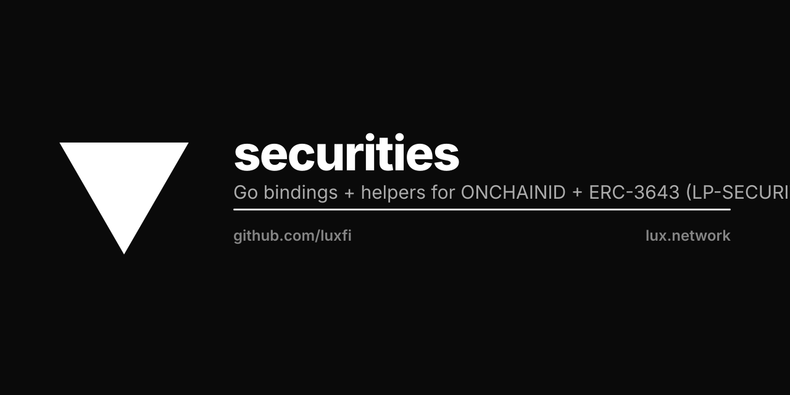

<p align="center"></p>

# lux/securities

Go bindings + ergonomic helpers for ONCHAINID and ERC-3643.

## Purpose

This module provides typed Go access to the canonical securities-token contract
suite adopted by Lux:

- `onchainid/` — ONCHAINID identity contracts (forked at luxfi/onchain-id, tracks
  onchain-id/solidity v2.2.2-beta3 verbatim).
- `erc3643/`  — ERC-3643 token + compliance suite (forked at luxfi/erc-3643,
  tracks ERC-3643/ERC-3643 v4.1.3 verbatim).

The Solidity sources are untouched. This package is the Go consumer surface used
by ATSv (luxfi/atsv) and downstream operators.

## Usage

```go
import (
    "github.com/luxfi/securities/onchainid"
    "github.com/luxfi/securities/erc3643"
)

id, err := onchainid.NewIdentity(client, common.HexToAddress("0x..."))
tok, err := erc3643.NewToken(client, common.HexToAddress("0x..."))
```

## Bindings

`go generate ./...` clones the pinned upstream tags into `contracts-vendored/`
and regenerates the abigen bindings. The vendored sources are gitignored — only
the generated `*_bindings.go` files are committed.

## License

Apache-2.0. The wrapper code is original Lux work.

The Solidity ABIs themselves originate from GPL-3.0 upstreams (ONCHAINID,
ERC-3643). Bindings generated from an ABI are not a derivative work of the
Solidity source at the binary level (no GPL-licensed code is linked into the
resulting Go binary), so wrapper consumers may use this package under Apache-2.0.

## Reference

LP-SECURITIES.md (luxfi/lps, branch lp-securities-tokeny-adopt-2026-04-28) is the
canonical adoption rationale.
